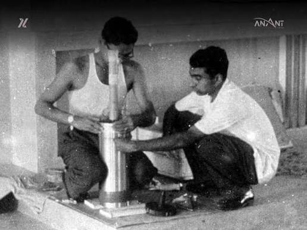
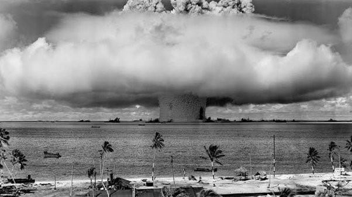
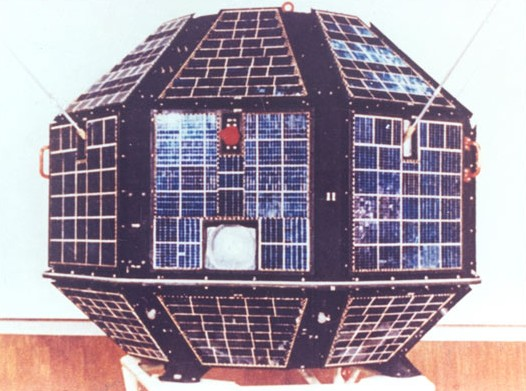
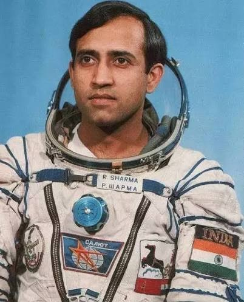
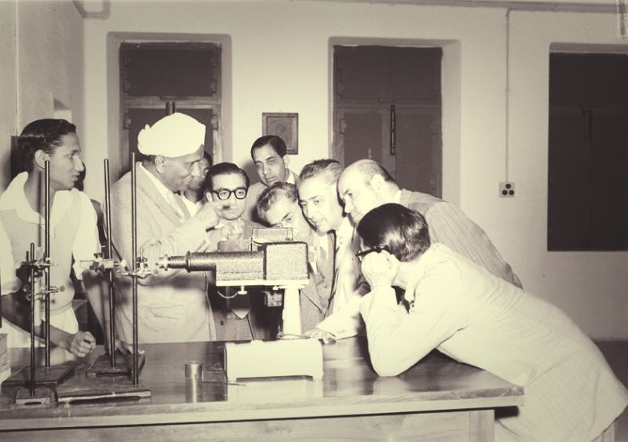

## Story

In the 1970s and 1980s India was still mainly an agrarian country, and its fortunes rose and fell with the monsoon.
Yet in those same years it kept surprising the world.

In 1974 it carried out its first nuclear test at Pokhran, code-named Smiling Buddha.

A year later its first satellite, Aryabhata, went into orbit.

In 1984 Squadron Leader Rakesh Sharma became the first Indian in space.

Each achievement raised the next ambition, and each ambition needed more computing power.
Forecasting the monsoon, designing satellites, modelling materials and searching for oil all required machines that could crunch numbers at enormous speed.

## Epilogue

The country had the talent, the skill and the knowledge.
The one thing holding it back was the machine.

