## Story

The monsoon decides India's fortunes.
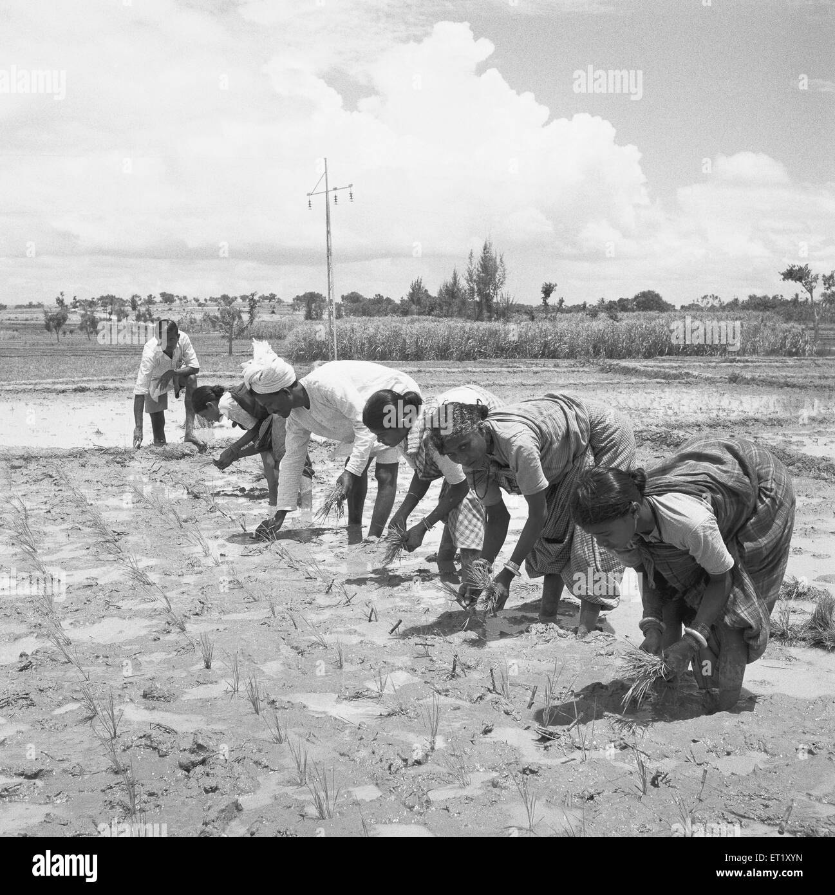
It fills the reservoirs, feeds the paddy, and in a bad year empties the granaries.
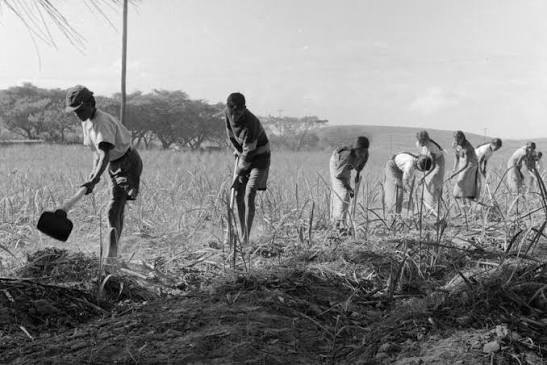
Yet weather forecasting in India was still primitive, too coarse to tell a farmer when to sow or harvest.
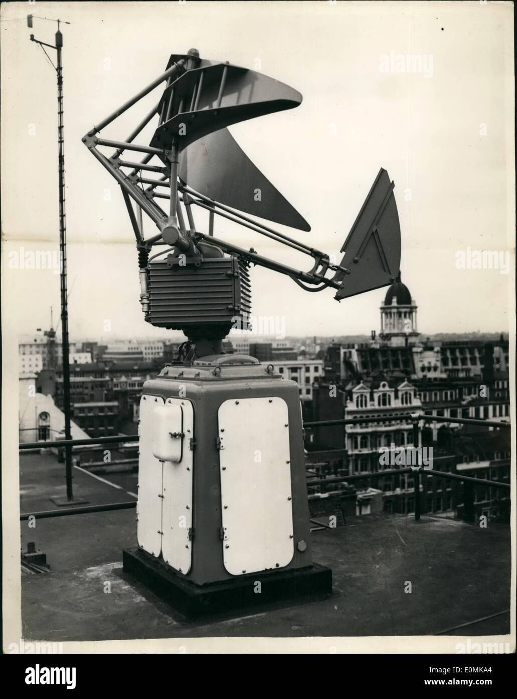
Good forecasting is a brutal computing problem: scores of factors must be modelled together, and real-time data from across the world has to be folded in before any forecast is meaningful.
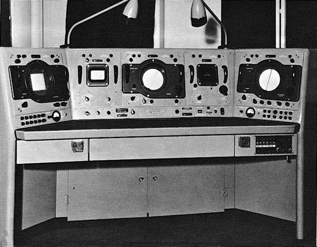
To do it with confidence, India's meteorologists needed a machine that could solve enormous systems of equations faster than the weather itself could change.

In 1987 there was one kind of machine built for that work, and it carried the name Cray.
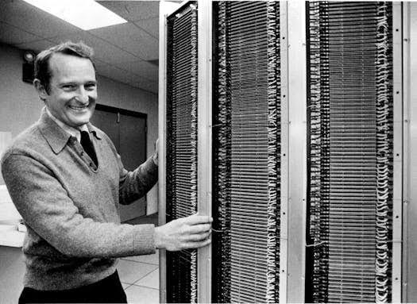
Supercomputers handled millions of equations at once through parallel processing, and the technology was tightly held by the United States.
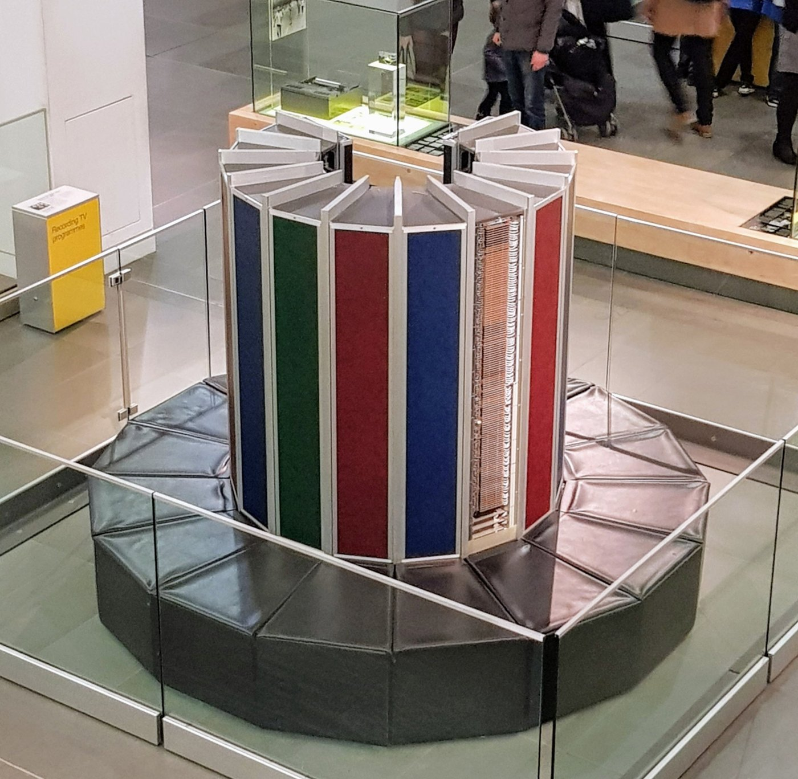
Its spin-offs reached into nuclear, space and weapons work, and Washington guarded it closely.
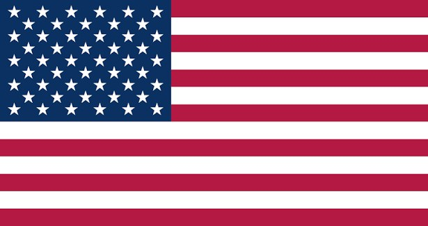

India had already bought a small Cray once, on terms that stung: it could be used only for weather forecasting, and only under American watch.
Now New Delhi wanted a more capable model, the Cray X-MP.
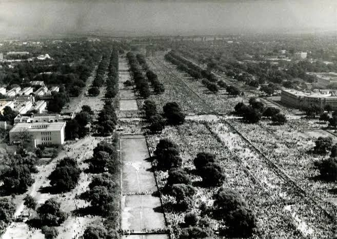
The negotiations had gone well.
Officials had been told the request was being viewed favourably.

Then the answer came.
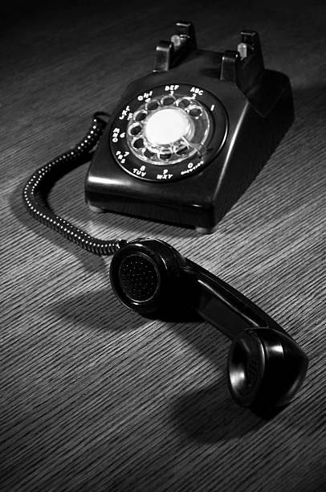

In the account of Sam Pitroda, the telecom engineer Prime Minister Rajiv Gandhi had made his technology adviser, it came as a phone call from President Ronald Reagan, and when Rajiv put the receiver down, his face had changed.
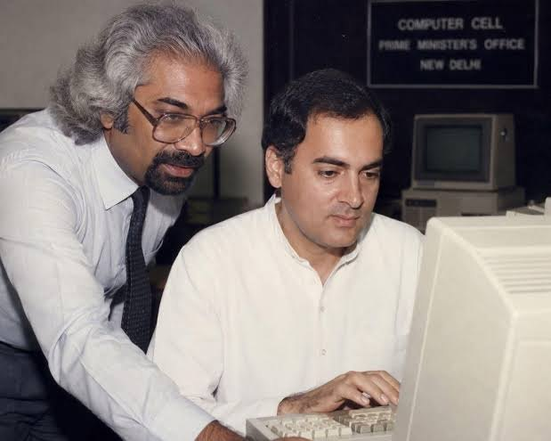
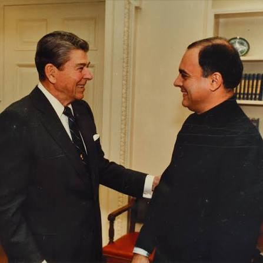
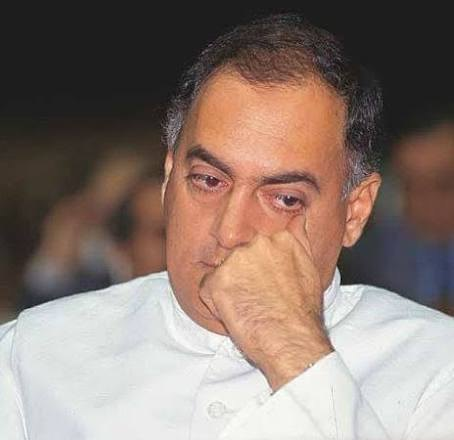
In the account carried in Dr Bhatkar's circle, it came in the form of preconditions so heavy and humiliating that no self-respecting nation could accept them.
Either way, the answer was no.
Washington feared that a supercomputer in Indian hands might help design nuclear weapons.
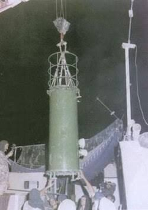

## Epilogue

A door shut in a nation's face turned out to be the first page of a different story.
