## Story

I was born on 11 October Nineteen Forty Six in Muramba, a village in Murtizapur taluka of Akola district, in the cotton country of Vidarbha.
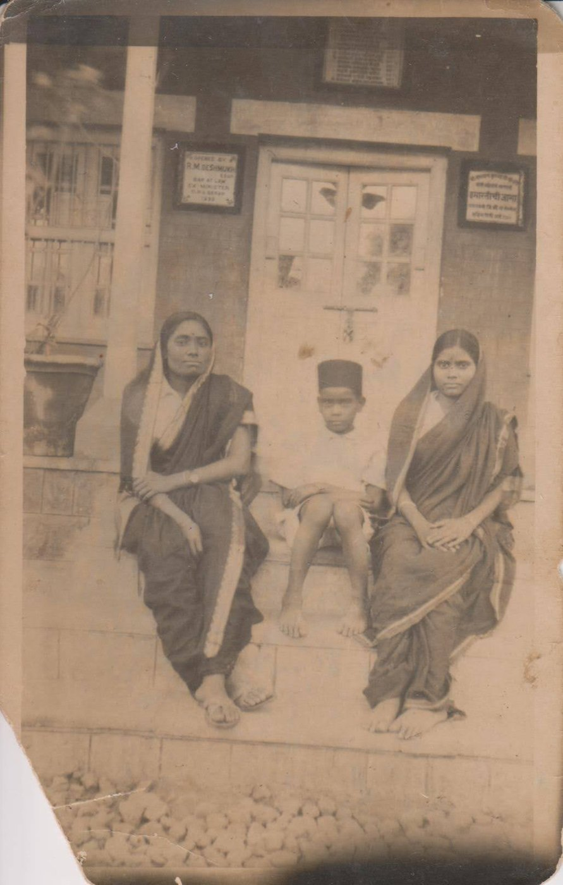
The story about my childhood is that I never sat in the first three classes of school at all.
I started directly in the fourth and kept up anyway.

My education was homegrown from beginning to end.
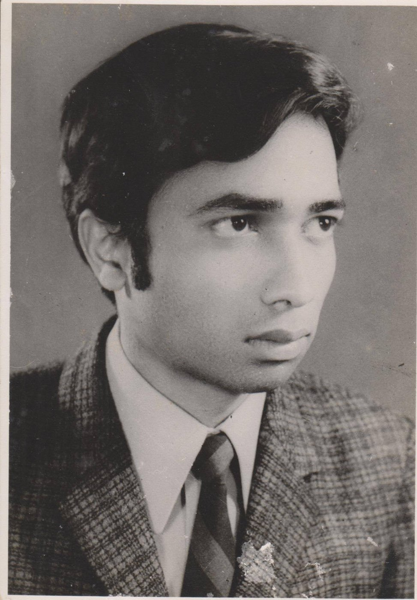
After a humble secondary school in Murtizapur, I took my B.Tech. at Visvesvaraya Regional College of Engineering (VRCE) in Nagpur, my MTech. in Electrical Engineering at the Maharaja Sayajirao University of Baroda, and my PhD at IIT Delhi.
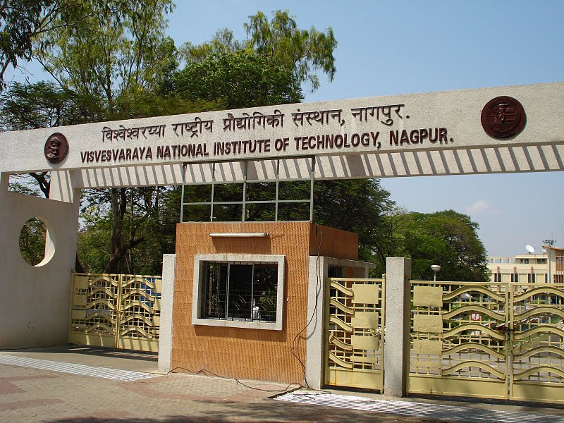
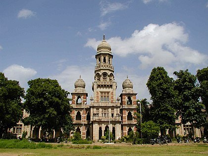
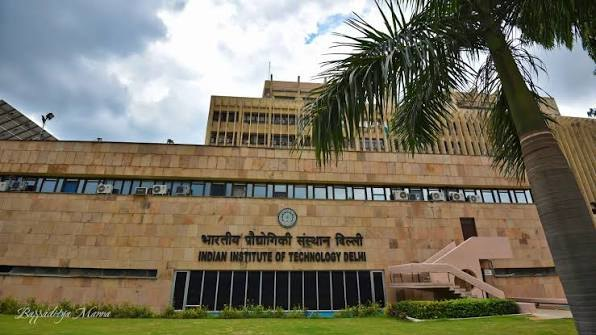
Computer science and electronics were not even subjects in my college days.
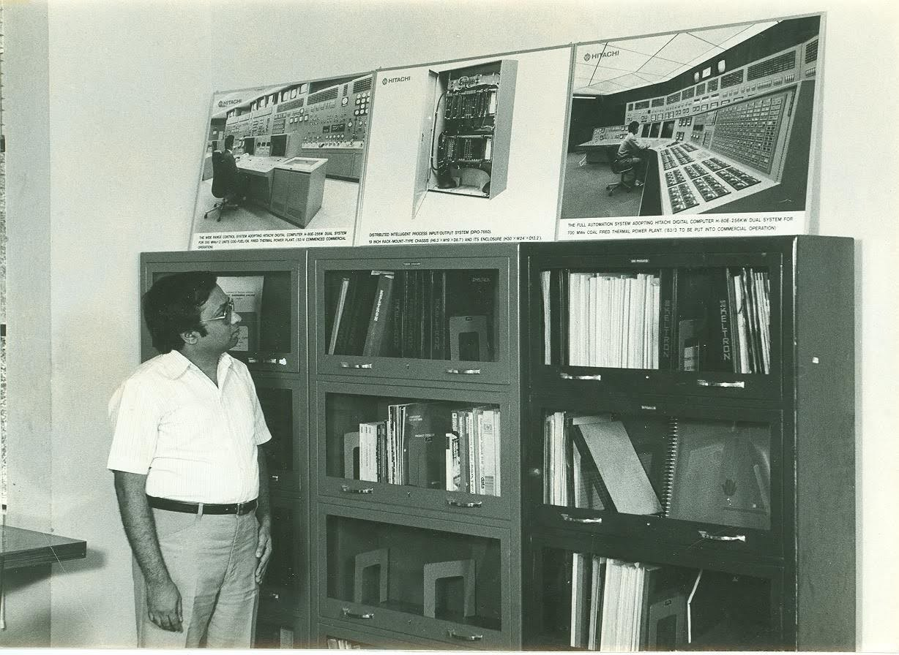
The only path open was electrical engineering, and I took it.
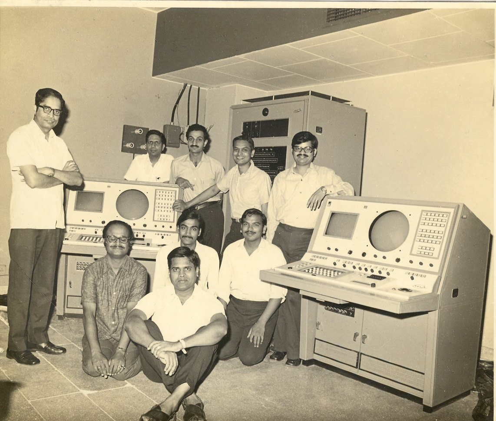

During my PhD I made a discovery about myself.
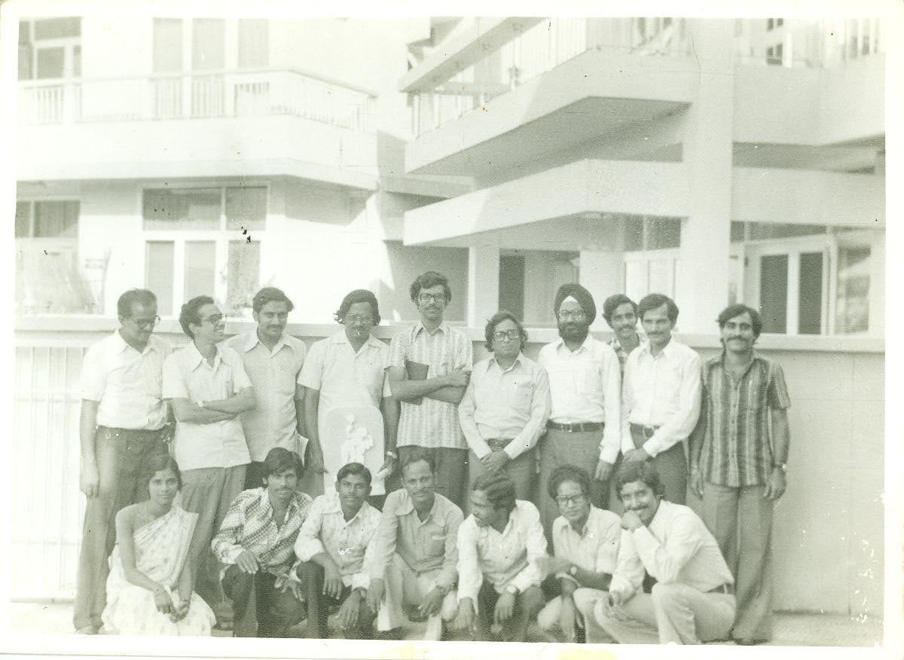
I had been trained as an engineer, at home with physics, but I realized that the deep problems I wanted to solve were really problems of mathematics.
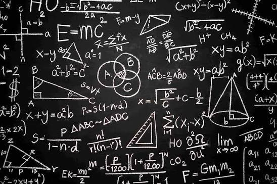
So, I taught myself MTech.-level mathematics from textbooks, and before long I was teaching mathematics to PhD students.
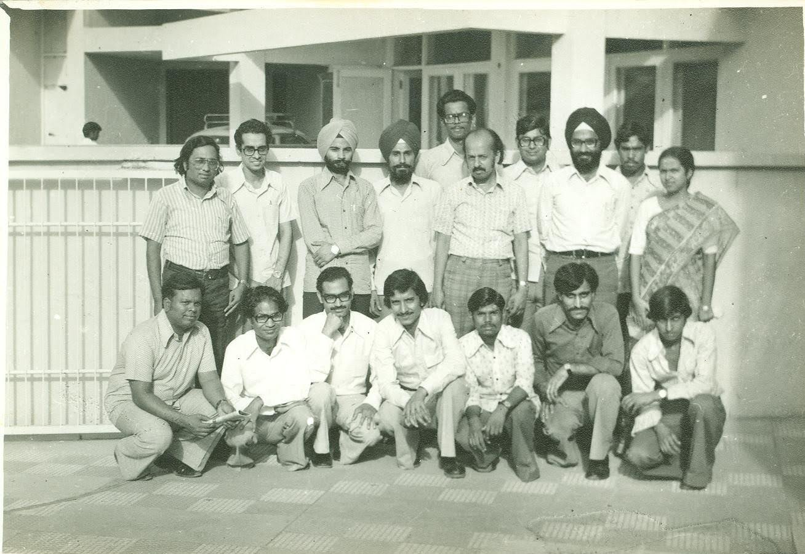
That self-taught command of mathematics would one day let me grapple with the nuances of high-performance computing.
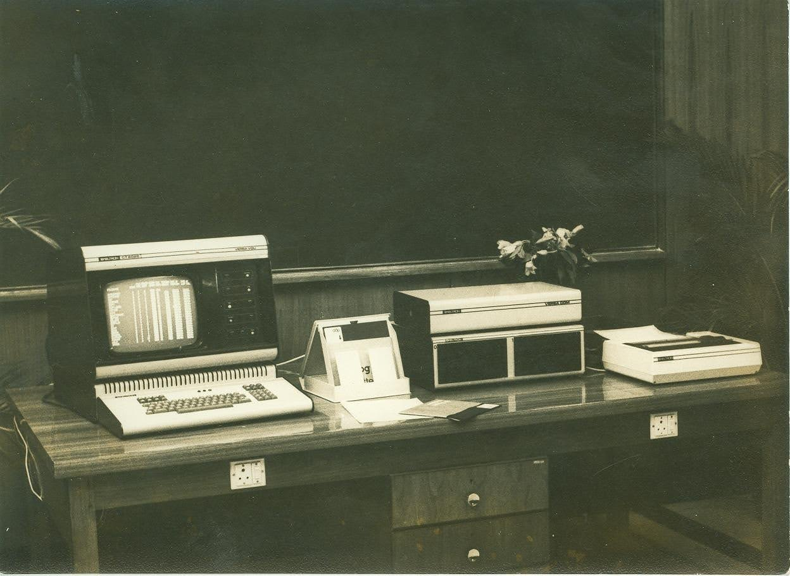

## Epilogue

I am, as those who know me like to say, a "Made in India" product — proof that a person does not need a foreign degree to accomplish the impossible.
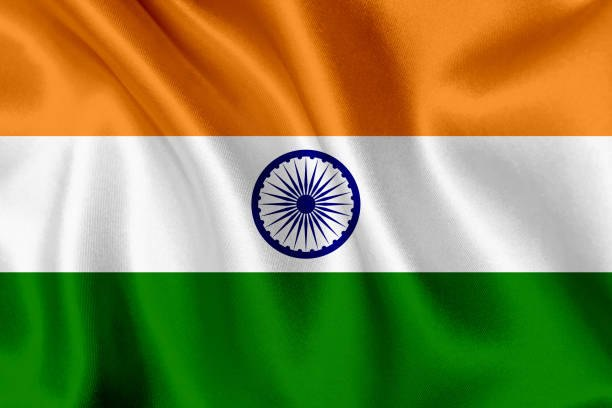
